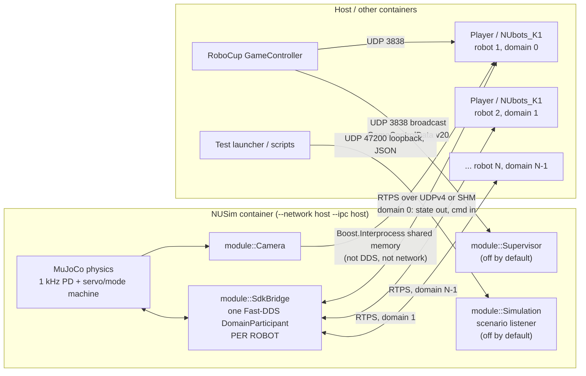
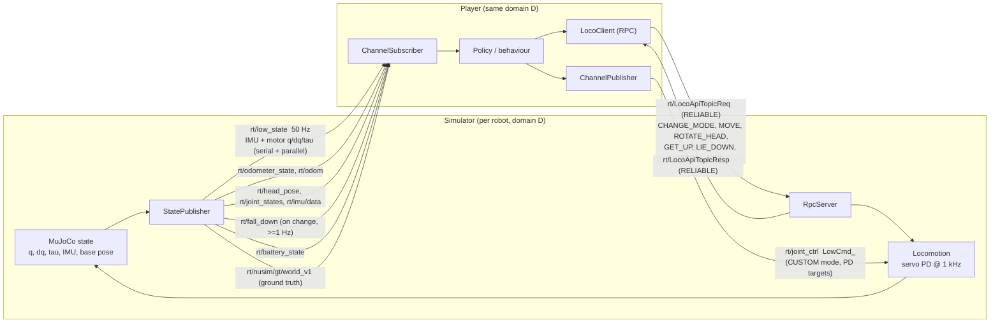
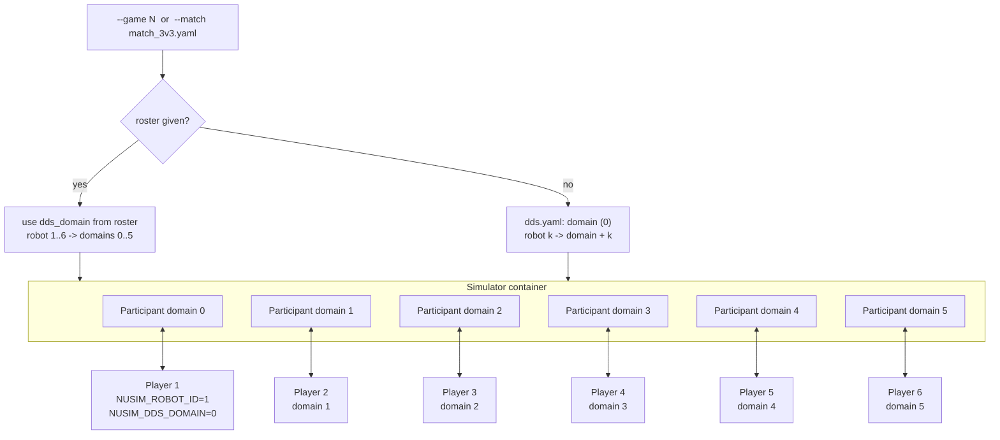
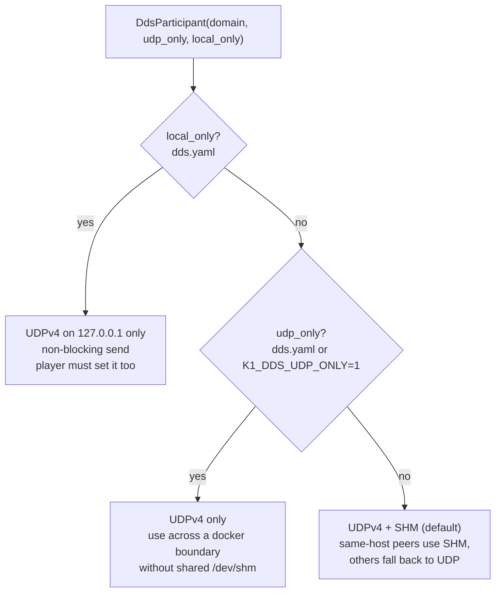

# External interfaces of the simulator container

How NUSim talks to the outside world: joint/sensor data out, commands in, and how several
robots are kept apart with one **DDS domain per robot**.

Sources: `mujoco/module/SdkBridge/` (`DdsParticipant.cpp`, `StatePublisher.cpp`, `PROTOCOL.md`),
`mujoco/config/{dds,simulation,supervisor,match_3v3}.yaml`, `mujoco/docker/k1sim.sh`.

## 1. Overview

The container runs with `--network host --ipc host`, so it shares the host's network stack and
`/dev/shm`. There is no port mapping. Everything below is visible on the host as if the simulator
were a native process.

## 2. Data direction: joints out, commands in

| Direction (from sim) | Topic | Rate / QoS |
|---|---|---|
| out | `rt/low_state` (joints + IMU) | 50 Hz, RELIABLE, VOLATILE, KEEP_LAST(5) |
| out | `rt/odometer_state`, `rt/odom`, `rt/head_pose`, `rt/joint_states`, `rt/imu/data`, `rt/battery_state` | same QoS |
| out | `rt/fall_down` | on change, at least 1 Hz keepalive |
| out | `rt/nusim/gt/world_v1` | ground truth for native players |
| in | `rt/joint_ctrl` (`LowCmd`) | PD-tracked at 1 kHz in CUSTOM mode |
| in | `rt/LocoApiTopicReq` | RELIABLE, KEEP_LAST(10) |
| out | `rt/LocoApiTopicResp` | RELIABLE, KEEP_LAST(5) |

Topic names are identical in every domain. The domain is what separates robots, not the name.

## 3. Multiple robots: one domain id each

Each robot gets its own `DdsParticipant` (`SdkBridge.cpp:51`,
`DdsParticipant(robot.dds_domain, udp_only, local_only)`). A DDS participant only discovers and
exchanges data with peers in the same domain, so robot 2's `rt/joint_ctrl` can never reach robot 1.

The player must call `ChannelFactory::Init(<its domain>)` before any hardware module starts.
NUbots' stock `HardwareIO` hardcodes `Init(0)`, so unmodified NUbots can only drive robot 1.

## 4. Ports and protocols

| What | Protocol | Port | Notes |
|---|---|---|---|
| Joint state out, commands in (all `rt/*` topics) | RTPS (DDS wire protocol) over **UDPv4**, plus **shared memory** by default | see table below | Fast-DDS 2.13, Booster SDK types |
| Camera frames | Boost.Interprocess shared memory, segment `_boostercamera_head_rgb` (rgb8 544x448 @ 30 Hz) | none | host-local only; needs `--ipc host` |
| Head pose to NUbots | shared memory, segment `_head_pose` | none | host-local only |
| GameController | UDP broadcast, GameControlData v20 | **3838** | NUbots binds it; sim Supervisor only if `enabled: true` |
| Scenario control | UDP, JSON | **47200**, loopback | `simulation.yaml: scenario_port`, 0 disables |

### RTPS port numbers per domain

The repo does not set explicit ports. It uses Fast-DDS default port mapping
(PB = 7400, DG = 250, PG = 2, d0 = 0, d1 = 10, d3 = 11), where `pid` is the participant index
within a process on that domain (0 for the first):

| Traffic | Formula | Domain 0 | Domain 1 | Domain 2 | Domain 3 | Domain 4 | Domain 5 |
|---|---|---|---|---|---|---|---|
| Discovery, multicast (239.255.0.1) | 7400 + 250 x D | 7400 | 7650 | 7900 | 8150 | 8400 | 8650 |
| Discovery, unicast | 7410 + 250 x D + 2 x pid | 7410 | 7660 | 7910 | 8160 | 8410 | 8660 |
| User data, unicast | 7411 + 250 x D + 2 x pid | 7411 | 7661 | 7911 | 8161 | 8411 | 8661 |

So separate domains also mean separate UDP port ranges, which you can see in `ss -ulpn`.
These are derived from the Fast-DDS defaults, not read from a config in this repo. Confirm on a
running sim with `ss -ulpn | grep -E '7[4-9]|8[0-6]'` if it matters. A custom
`FASTRTPS_DEFAULT_PROFILES_FILE` could change them.

### Transport selection

With the default transport, two processes on the same host mostly talk over shared memory, so you
will see little UDP traffic for data even though UDP ports are open for discovery.

## 5. Caveats

- `FASTRTPS_DEFAULT_PROFILES_FILE` must point to an XML with a participant profile named
  `booster_dds`, or the Booster SDK fails with `Failed to create participant`. `./b run` sets it.
- The Supervisor is off by default because both it and NUbots would bind UDP 3838. A second binder
  breaks NUbots with `Address already in use`.
- Port 3838 is shared by every robot. GameController is not per-domain.
